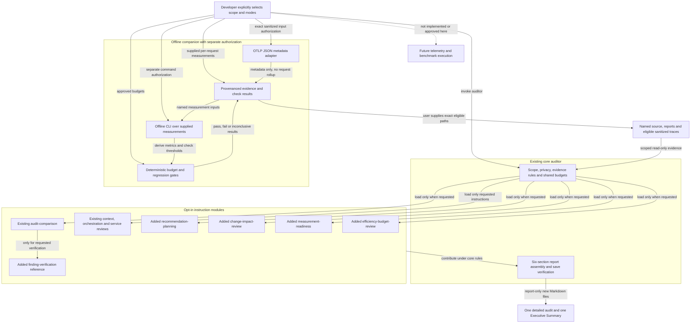
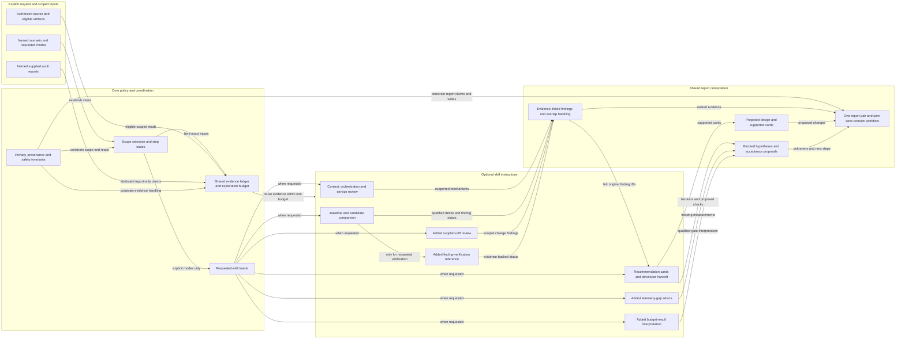

# Architecture Diagram

Modular architecture for the AI Efficiency & Performance Auditor and its
offline companion. This is a component view, not a deployed service or proof
of live agent behavior. Skills are selectively loaded instructions in one auditor session,
not independent agents, services or executable plugins.

## Application Architecture

Solid arrows show existing architectural relationships; dotted arrows show
future additions. Added skills have declaration/manual coverage, not new live
validation. The companion handles supplied files only; collection and application
workload execution remain outside the approved offline scope.

<!-- mermaid-checked: no \n, no em-dash/en-dash, no {} in labels, subgraphs are id["label"], arrows are -->|"label"|, all subgraphs closed by end, ids unique -->

### Technology Stack Summary

| Layer | Technology | Version | Purpose |
|---|---|---|---|
| Host | GitHub Copilot custom-agent support in VS Code or CLI | Host-dependent | Explicit user invocation; cloud remains experimental |
| Core | Markdown agent definition | Methodology 0.5.0 candidate | Shared scope, evidence, privacy, budgets and reporting |
| Analysis modules | Opt-in Markdown SKILL.md directories | Repository revision | Specialized analysis and handoff instructions, no new tools |
| Evidence semantics | Internal advisory evidence and Markdown contracts | advisory-evidence/1; advisory-markdown/1 | Consistent provenance, units, unknowns and non-overlapping findings |
| Output | Markdown | Not applicable | One detailed report and one bounded Executive Summary |
| Companion tooling | Python standard-library adapter and gate CLI | auditor-traces/1; auditor-measurements/1; auditor-budgets/1; auditor-gate/1 | Offline supplied-evidence import and calculation; no acquisition or workloads |

### Data Storage & External Services

The auditor reads authorized workspace evidence and creates new report Markdown
under the existing no-overwrite workflow. No application database, telemetry
backend or direct external-service connection is required or introduced.
The companion requires confirmation of already-sanitized OTLP input and copies
allowlisted metadata only. It separately checks approved budgets over prepared
per-request measurements; it does not infer request populations from spans.
The auditor does not invoke the companion. Neither an output marker nor an
adapter establishes input privacy or overrides the core evidence eligibility gate.

### Key Architectural Decisions

- Keep the core small: safeguards and report contracts remain shared; specialized
  instructions load only for explicitly requested modes. Combining modes adds
  neither permissions nor exploration budgets.
- Keep execution separate: skills recommend experiments and instrumentation;
  the authorized offline companion only imports supplied evidence and computes
  CI-friendly gate results. No collection, benchmarking, installed CI integration
  or core-to-runner execution edge is introduced.
- Keep evidence honest: supplied reports are attributed rather than reverified,
  hypotheses stay unranked, and fewer calls alone do not prove improved quality.

## Component Relationships

The core coordinates instruction loading, evidence reuse and a single report
pair. Solid arrows describe current responsibilities; dotted arrows describe
future modules or extensions. The companion tooling boundary is shown above,
not implemented by these instruction components.

<!-- mermaid-checked: no \n, no em-dash/en-dash, no {} in labels, subgraphs are id["label"], arrows are -->|"label"|, all subgraphs closed by end, ids unique -->

### Component Inventory

| Component | Layer | Type | Responsibility |
|---|---|---|---|
| Scope selection and stop states | Core | Existing instructions | Bind the target; stop on missing or ambiguous scope; named-report-only planning skips app discovery |
| Requested-skill loader | Core | Existing routing instructions | Read only explicitly requested skill guidance; disclose missing modules |
| Shared evidence ledger and budget | Core | Existing audit method | Reuse reads, preserve provenance and unknowns, enforce one shared exploration budget |
| Privacy and safety invariants | Core | Existing cross-cutting instructions | Preserve sanitization, authorization, freshness, idempotency, quality and permission boundaries |
| Context, orchestration and service review | Skills | Existing optional modules | Specialized efficiency and service analysis |
| Audit comparison | Skills | Existing optional module | Establish comparability and qualified deltas; no resolution from omitted findings |
| Recommendation planning | Skills | Added optional module | Smallest proposed change, dependencies, effort rationale, safeguards, acceptance and rollback |
| Change-impact review | Skills | Added optional module | Analyze supplied changes and affected call paths without a whole-app re-audit |
| Measurement readiness | Skills | Added optional module | Identify telemetry gaps and advise on payload-free instrumentation without installing it |
| Finding verification | Comparison | Added opt-in reference | Verify individual findings using matched candidate evidence and approved quality/safety results |
| Efficiency-budget interpretation | Skills | Added optional module | Explain separately computed results against approved limits, including inconclusive outcomes |
| Evidence-linked findings | Reporting | Existing shared method | Link mechanisms and IDs; avoid duplicate findings and overlapping benefit claims |
| Proposed design and validation plan | Reporting | Existing sections with added cards | Keep supported changes separate from blocked hypotheses and unapproved thresholds |
| Report persistence | Reporting | Existing workflow | Create one no-overwrite report pair; read back; preview only after explicit consent |

Generated finding IDs remain audit-local unless supplied identity and matching
evidence support continuity. Recommendation cards do not establish that work is
implemented, resolved or validated. All skill behavior remains instruction-based,
not a filesystem sandbox or a guarantee of host enforcement.

See the [extension roadmap](../../../../../docs/agent-guide.md#modular-design-and-extension-roadmap)
and [recommendation-planning usage](../../../../../docs/usage-prompts.md#recommendation-planning).
The [offline companion guide](../../../../../docs/offline-tooling.md) defines
supported formats, limitations, approved-budget policies and CI exit codes.
